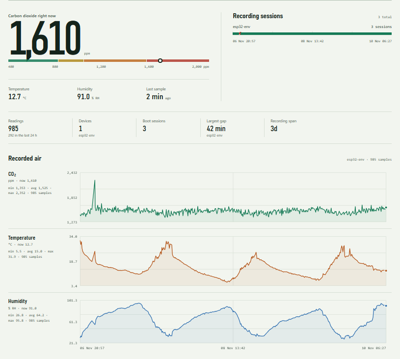

# Telemetry Pipeline

<details>
<summary><b>Table of Contents</b></summary>

- [Overview](#overview)
- [Components](#components)
- [The Server](#the-server)
  - [Volumes](#1-volumes)
  - [Ingest](#2-ingest)
  - [Readings](#3-readings)
  - [Fin](#4-fin)

</details>

This section is going to get documented just in case. Although the setup process for the data collection isn't necessarily relevant to the project, it may be worth documenting and explaining if it does need to be explained.

This section documents how sensor readings get from an ESP32 onto a home server Network Attached Storage (NAS).

---

## Overview

The main challenge that is faced when using a microcontroller for getting data is that there is nowhere for it to be stored on the device. Additionally, it would be nice to be able to see the data from multiple devices. To overcome these issues, a server was used to set up an ingest proxy as well as host a dashboard that allows us to view the data.

```
                       Proxmox host               NAS storage
                     ┌──────────────────────┐
   ESP32 ──POST──▶   │ CT 100 "ingest"      │
   JSON + token      │ 0.0.0.0:8080         │
                     └──────────┬───────────┘
                                │ SQLite (WAL)
                                ▼
                     ┌──────────────────────┐     ┌─────────────────┐
                     │ /srv/nas  (mp1)      │────▶│ pve-nas 295 GB  │
                     └──────────┬───────────┘     └─────────────────┘
                                │ also mp0
                                ▼
                     ┌──────────────────────┐     ┌─────────────────┐
                     │ CT 200 "nas" (Samba) │────▶│ \nas\files      │
                     └──────────────────────┘     │ (SMB share)     │
                                                  └─────────────────┘
```

Two containers share one storage volume: the **ingest** container writes the database, and the **nas** container serves that same directory over SMB.

---

## Components

| Component       | What it is                                     | Address / path                      |
| --------------- | ---------------------------------------------- | ----------------------------------- |
| Proxmox host    | Hypervisor running both containers             | `192.168.1.204`                     |
| CT 100 `ingest` | Unprivileged container, 1 core / 512 MB / 8 GB | `192.168.100.50/24`                 |
| CT 200 `nas`    | Unprivileged container, Samba file server      | host-managed DHCP                   |
| Storage         | LVM volume `pve-nas`, 295 GB                   | `/srv/nas`                          |
| Project tree    | Code, data, hardware notes                     | `/srv/nas/scifair/`                 |
| Database        | SQLite, WAL mode                               | `/srv/nas/scifair/Data/readings.db` |
| SMB share       | Exports `/srv/nas`                             | `\\nas\files`                       |
| Ingest API      | Python `ThreadingHTTPServer`                   | `http://192.168.100.50:8080`        |

---

## The Server

### 1. Volumes

The NAS storage is a single Logical Volume Manager (LVM) volume mounted at `/srv/nas` on the host. Rather than copying files between containers, the same directory is bind-mounted into both of them:

- **CT 1**: `mp1: /srv/nas,mp=/srv/nas,backup=0`
- **CT 2**: `mp0: /srv/nas,mp=/srv/nas`

`backup=0` on the ingest side keeps bulk media out of container backups.

### 2. Ingest

A small Python server listening on **`0.0.0.0:8080`**, run under systemd as `ingest.service` with a hardened unit: `ProtectSystem=strict`, `ProtectHome`, `PrivateTmp`, `NoNewPrivileges`, and `RestrictAddressFamilies`. Configuration comes from `/etc/ingest/ingest.env`, which holds the database path and the bearer token.

It exposes exactly two routes:

| Route          | Purpose         | Response              |
| -------------- | --------------- | --------------------- |
| `GET /healthz` | liveness        | `200 {"ok": true}`    |
| `POST /ingest` | accept readings | `202 {"accepted": N}` |

The database is created on first start, in Write Ahead Logging (WAL) mode with `synchronous=FULL`, with this shape:

```sql
CREATE TABLE readings (
    id        INTEGER PRIMARY KEY AUTOINCREMENT,
    device    TEXT    NOT NULL,
    boot      TEXT    NOT NULL,
    seq       INTEGER NOT NULL,
    timestamp TEXT    NOT NULL,   -- UTC, ISO-8601
    temp      REAL,
    humidity  REAL,
    co2       INTEGER,
    UNIQUE (device, boot, seq)    -- idempotency key
);
```

> [!NOTE]
> WAL mode is a persistence mode for Structure Query Langauge (SQL) databases which writes to another file instead of overwriting the main database. The reasons for this are not relevant and will thus be omitted from this documentation.

### 3. Readings

The ESP32 posts a batch to `/ingest` with a bearer token:

```json
{
  "device": "esp32-01",
  "boot": "1793574771",
  "rows": [{ "seq": 1, "temp": 21.5, "humidity": 40.2, "co2": 812 }]
}
```

- `device` which sensor node
- `boot` a value unique to this power-on (a UNIX timestamp works)
- `seq` a counter that increases across the boot session
- the server stamps `timestamp` itself, in UTC

Together, `(device, boot, seq)` is unique, and inserts are `INSERT OR IGNORE`. Replaying the same batch is therefore harmless. It stores nothing new and answers `202 {"accepted": 0}`.

### 4. Fin

The `nas` container shares `/srv/nas` over SMB, so the database is visible to the entire network.

Since the database runs in **WAL mode** the most recent data live in `readings.db-wal` and only get folded into `readings.db` at a checkpoint. A copy of the `.db` file alone can be stale.

```
Total rows: 2   showing: 2   snapshot: readings.db, readings.db-wal, readings.db-shm

id device   boot       seq timestamp                 temp humidity co2
-- ------   ----       --- ---------                 ---- -------- ---
 3 esp32-01 1793574771   1 2026-11-01T23:12:51+00:00 21.5 40.2     812
 1 test     b1           1 2026-11-01T17:54:36+00:00 21.5 40       800
```

## The Dashboard



The dashboard is absolutely not relevant but was nice to have to make sure that the data was

1. Still streaming (the ESP didn't die on us)
2. Giving data that wasn't off

The dash was hosted on the same container as the ingest script and runs on a simple python script and cron job that refreshes every 5 minutes.
